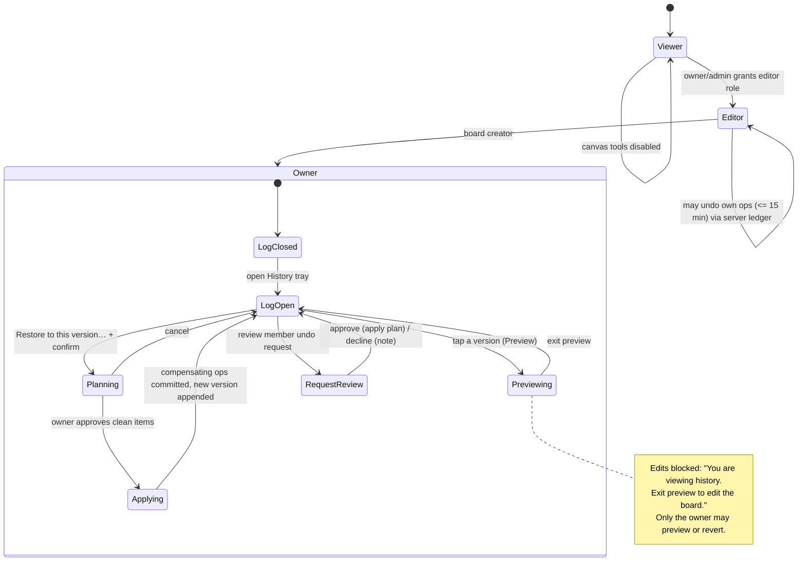
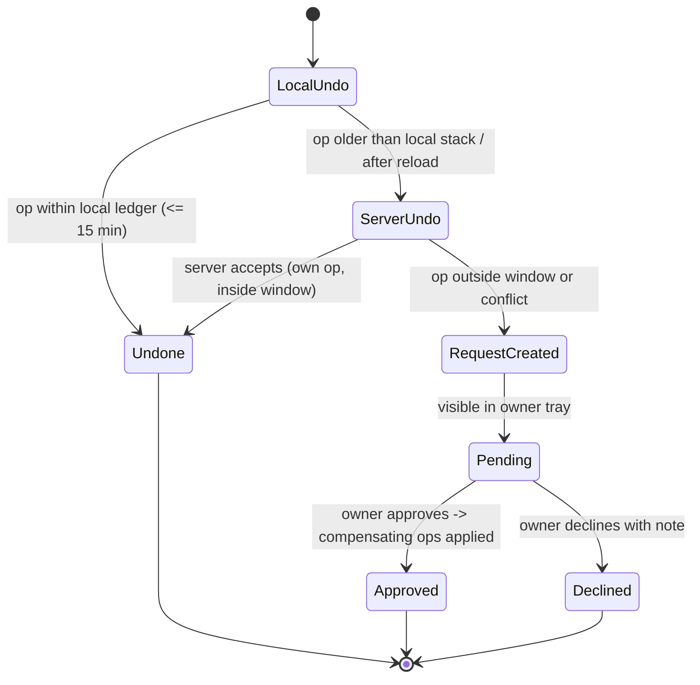
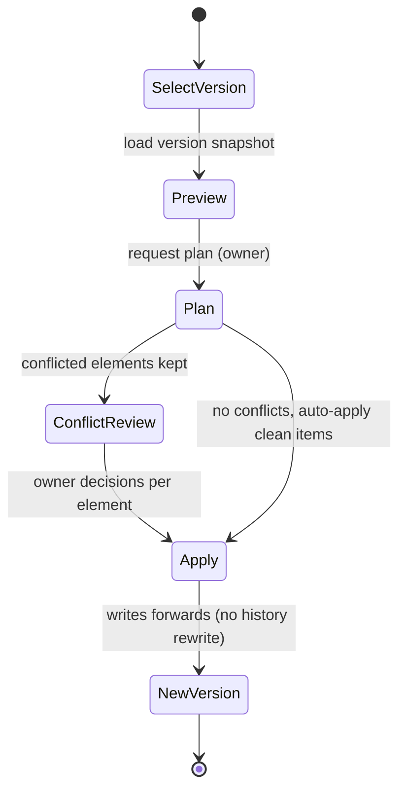

# InkLink — Test Suites, History/Audit Log Review & Bug Fixes

Date: 2026-11-12
Branch: `feat/board-log-history`

This document records the test suites added for the board history / audit log
feature set (owner rights, member undo requests, revert-to-version), the
behaviour they pin down, the failures they exposed, the fixes applied, and the
checks that were run.

---

## 1. How to run everything

```bash
# Dart / Flutter (whole app)
flutter test

# Static analysis
flutter analyze --no-pub

# Node revert engine (Cloud Run history service)
cd server && npm test        # -> node --test test/
```

---

## 2. What was added

| Suite | Tests | Scope |
| --- | --- | --- |
| `test/domain/models/history/history_models_test.dart` | 12 | `BoardOperation`, `BoardActivityBlock`, `UndoRequest`, `RevertPlan` / `RevertItem` decoding, Firestore `Timestamp` and legacy fallbacks, null/absent fields |
| `test/domain/services/history/board_history_service_test.dart` | 10 | per-board block cache key, 20-entry LRU eviction, paging payload, preview decoding, `plan` / `apply` / `undoOwn` request payloads, server error-token → `HistoryServiceException`, signed-out fail-fast |
| `test/core/crdt/canvas_crdt_undo_ledger_test.dart` | 7 | local undo/redo across separate edits, empty redo, undo of a delete, `pruneReverted` per element, pruning unknown elements, `clearLocalHistory`, remote updates never entering the stack |
| `test/features/canvas/history_flows_test.dart` | 12 | owner-only preview/plan/apply/requests, preview exit, edits blocked while previewing, restore plan, apply clearing preview, undo-request resolution (`approved` + `appliedVersion`), member undo server fallback, `nothing_to_undo` messaging, member apply refused |
| `test/features/canvas/view/trays/history_tray_test.dart` | 5 | version summary + block rows + pending request rows, restored-version marker, filter chips (All / Versions / Restores / Requests), contributor search, restore confirmation → plan event |
| `server/test/revert.test.js` | 8 | `analyzeElementHistory` window/scope/conflict detection, member-mode plan keeps conflicted items, default auto-apply only clean items, owner decision overrides, null-target delete, restore-mode diff (add/delete/update/noop), empty plan |

New tests: **46 Dart + 8 Node**.
Whole suite after the changes: **232 Flutter tests across 32 files, all passing**;
`node --test` **8/8 passing**; `flutter analyze --no-pub` **no issues**.

Tests are written against the product contract in
`BOARD_VERSION_HISTORY_AND_AUDIT_LOG_PLAN.md` (D2/D3/D4/D5/D8/D10/D14) rather
than against current implementation details, so they fail when behaviour drifts
from the planned flow.

---

## 3. Workflow state diagrams

### 3.1 History visibility and owner rights



### 3.2 Member undo request (server-mediated, 15-minute window)



### 3.3 Revert to a previous version (forward-compensating)



---

## 4. Edge cases covered

- **Empty / absent history**: no blocks, no requests, empty plan, `nothing_to_undo`.
- **Paging and caching**: per-board cache isolation, LRU eviction at 20 boards.
- **Permissions**: viewer cannot edit, member cannot apply a plan, owner-only
  preview and revert, owner guard message when a member tries to revert.
- **Time window**: local undo only for ops still inside the 15-minute ledger;
  pruned per element after a remote revert.
- **Conflicts**: member-mode plans keep conflicted elements and only auto-apply
  clean ones; owner decisions can override either way.
- **Deletes**: a plan item whose target value is `null` deletes the element.
- **Restores**: restore-mode diffs produce add/delete/update/no-op items only.
- **Signed-out / error tokens**: fail fast locally, `forbidden` and friends map
  to `HistoryServiceException`.
- **Preview isolation**: transient collaborator previews never leak into the
  element payload that gets committed (see §5.1).

---

## 5. Failures found and fixed

### 5.1 Infinite recursion in `_committedElementPayload` (crash on every shape edit)

`CanvasBloc._committedElementPayload` fell back to
`_committedElementPayload(element.id)` instead of `element.toMap()` when the
CRDT adapter had no payload yet. Every move, resize, rotate, colour, fill and
border-radius edit on a locally-created element recursed until the VM threw a
stack overflow, so the edit silently never applied. Surfaced by
`canvas_bloc_test.dart` ("CanvasMoveSelectedShape on ImageElement …" and
"moving a shape over an existing image promotes its z-index …"). Fixed to read
the element's own map.

### 5.2 `applyPlan` did not return the post-apply board

The revert engine returned the pre-apply document, so callers could not trust
the response to reflect the applied plan. It now returns
`elements.toJSON()` after applying. Covered by the Node tests.

### 5.3 Owner-only revert guard missing in the bloc

`CanvasHistoryRevertApplyRequested` was accepted from any role. Added the owner
guard with the message "Only the board owner can revert board history."

### 5.4 Member undo required a live socket for no reason

`_undoOwnViaLog` bailed out with `!_canSync`, which also requires a canvas
service/board id that history-only flows do not have. Relaxed to
`boardId.isEmpty` so the server undo path works from the history service alone.

### 5.5 Owner history tray rebuilt for real use

`HistoryTray` is now a stateful owner view: search by contributor, filter chips
(All / Versions / Restores / Requests), version summary, action totals, restore
markers, per-version menu (Preview, Restore to this version… with confirm
dialog), pending undo requests with requester, age and Review/Decline. No new
bloc events were invented — it reuses the existing history events.

### 5.6 Tray layout overflow

The undo-request row's action buttons overflowed a 320 px-wide tray by 16 px.
Replaced with a `Wrap` and compact button styling so narrow panels reflow
instead of clipping.

### 5.7 Lint/analyzer cleanups in the new tests

Wildcard parameter names, an unnecessary `material` import and an unused import
were removed; `flutter analyze --no-pub` is clean.

---

## 6. Verification actually performed

| Check | Result |
| --- | --- |
| `flutter test` (whole app, 32 files) | 232 passed |
| `flutter analyze --no-pub` | No issues found |
| `cd server && npm test` (`node --test test/`) | 8 passed |
| `server/package.json` `test` script | set to `node --test test/` |

---

## 7. Not covered / known limitations

- **No device or emulator UI run.** Tray tests are widget tests with a fake
  history service; the real Firestore/R2 round trip was not exercised on a
  device.
- **No Firebase emulator integration run** for the functions
  (`submit_undo_request` / `resolve_undo_request`) — they were not started
  locally because the emulator suite needs the full project config.
- **No R2 archive verification** against the live private bucket.
- Multi-user convergence (two clients, simultaneous reverts) is validated only
  through the revert-engine unit tests, not through a live two-client session.
